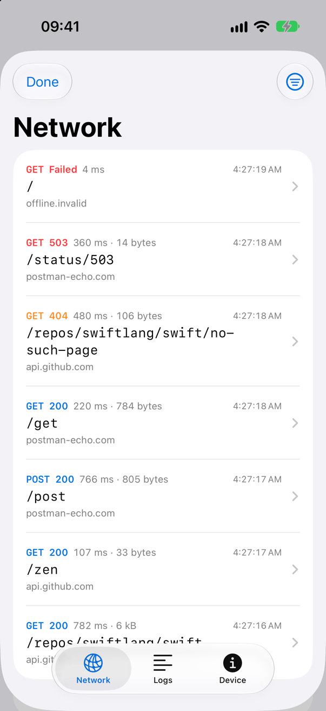
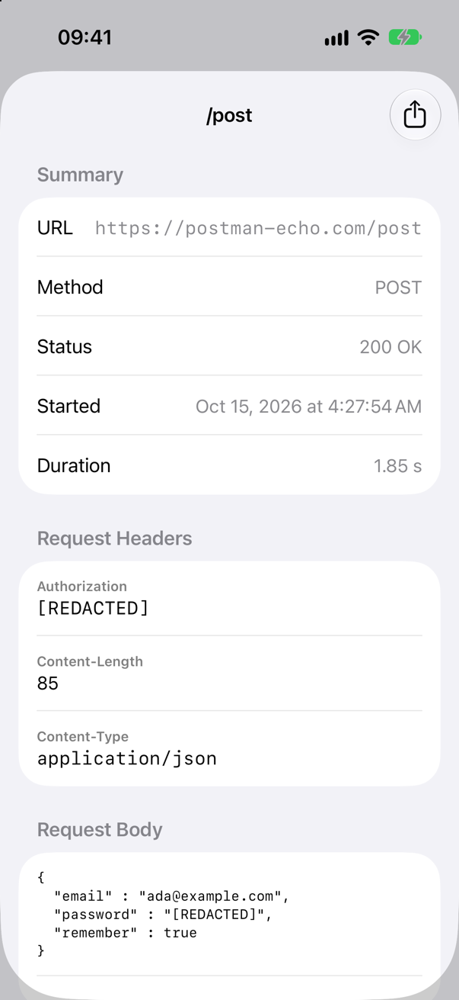
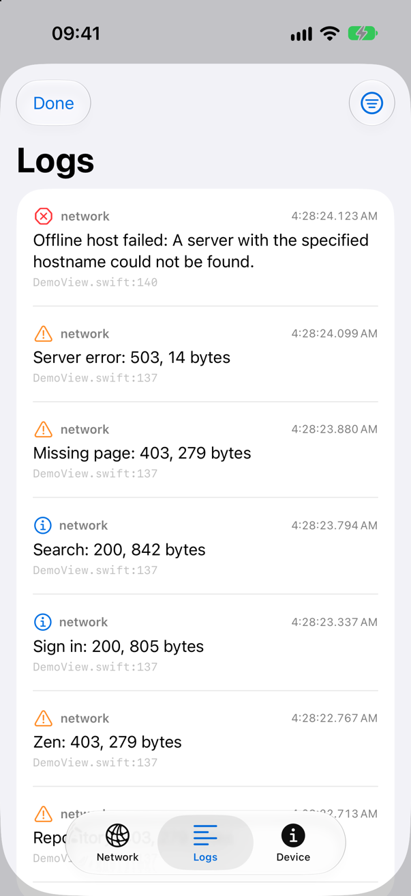
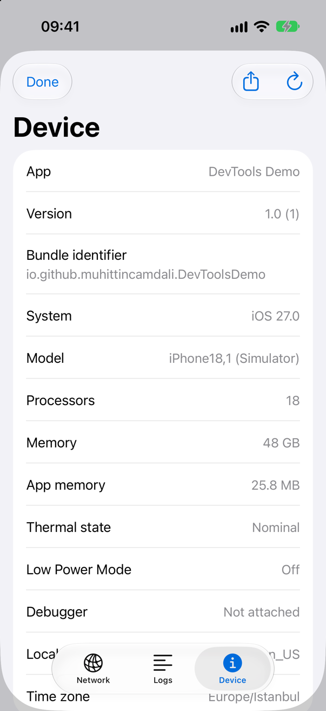

<!-- i18n-source: README.md@fbf2dd5bb72dde66bfdd8caa9db66f9061072989 status=reviewed -->
<!-- brand:start -->

<p align="center"><picture><source media="(prefers-color-scheme: dark)" srcset="https://raw.githubusercontent.com/muhittincamdali/iOSDevelopmentTools/master/.github/brand/banner-pt-BR-dark.svg"><source media="(prefers-color-scheme: light)" srcset="https://raw.githubusercontent.com/muhittincamdali/iOSDevelopmentTools/master/.github/brand/banner-pt-BR-light.svg"></picture></p>

<!-- lang-selector:start -->
<p align="center"><a href="README.md">English</a> · <a href="README.tr.md">Türkçe</a> · <a href="README.zh-CN.md">简体中文</a> · <a href="README.ja.md">日本語</a> · <a href="README.ko.md">한국어</a> · <a href="README.es.md">Español</a> · <a href="README.de.md">Deutsch</a> · <a href="README.fr.md">Français</a> · <a href="README.pt-BR.md">Português (Brasil)</a> · <a href="README.ru.md">Русский</a></p>
<!-- lang-selector:end -->

<p align="center">
<a href="https://github.com/muhittincamdali/iOSDevelopmentTools/actions/workflows/ci.yml"></a>
<a href="https://github.com/muhittincamdali/iOSDevelopmentTools/releases"><picture><source media="(prefers-color-scheme: dark)" srcset="https://raw.githubusercontent.com/muhittincamdali/iOSDevelopmentTools/master/.github/brand/badge-version-dark.svg"><source media="(prefers-color-scheme: light)" srcset="https://raw.githubusercontent.com/muhittincamdali/iOSDevelopmentTools/master/.github/brand/badge-version-light.svg"></picture></a>
<a href="https://github.com/muhittincamdali/iOSDevelopmentTools/blob/master/Package.swift"><picture><source media="(prefers-color-scheme: dark)" srcset="https://raw.githubusercontent.com/muhittincamdali/iOSDevelopmentTools/master/.github/brand/badge-platforms-dark.svg"><source media="(prefers-color-scheme: light)" srcset="https://raw.githubusercontent.com/muhittincamdali/iOSDevelopmentTools/master/.github/brand/badge-platforms-light.svg"></picture></a>
<a href="https://github.com/muhittincamdali/iOSDevelopmentTools/blob/master/Package.swift"><picture><source media="(prefers-color-scheme: dark)" srcset="https://raw.githubusercontent.com/muhittincamdali/iOSDevelopmentTools/master/.github/brand/badge-language-dark.svg"><source media="(prefers-color-scheme: light)" srcset="https://raw.githubusercontent.com/muhittincamdali/iOSDevelopmentTools/master/.github/brand/badge-language-light.svg"></picture></a>
<a href="https://github.com/muhittincamdali/iOSDevelopmentTools/blob/master/LICENSE"><picture><source media="(prefers-color-scheme: dark)" srcset="https://raw.githubusercontent.com/muhittincamdali/iOSDevelopmentTools/master/.github/brand/badge-license-dark.svg"><source media="(prefers-color-scheme: light)" srcset="https://raw.githubusercontent.com/muhittincamdali/iOSDevelopmentTools/master/.github/brand/badge-license-light.svg"></picture></a>
</p>

<p align="center">
<a href="#início-rápido"><picture><source media="(prefers-color-scheme: dark)" srcset="https://raw.githubusercontent.com/muhittincamdali/iOSDevelopmentTools/master/.github/brand/button-start-pt-BR-dark.svg"><source media="(prefers-color-scheme: light)" srcset="https://raw.githubusercontent.com/muhittincamdali/iOSDevelopmentTools/master/.github/brand/button-start-pt-BR-light.svg"></picture></a>
<a href="https://muhittincamdali.github.io/iOSDevelopmentTools/documentation/iosdevelopmenttools/"><picture><source media="(prefers-color-scheme: dark)" srcset="https://raw.githubusercontent.com/muhittincamdali/iOSDevelopmentTools/master/.github/brand/button-docs-pt-BR-dark.svg"><source media="(prefers-color-scheme: light)" srcset="https://raw.githubusercontent.com/muhittincamdali/iOSDevelopmentTools/master/.github/brand/button-docs-pt-BR-light.svg"></picture></a>
<a href="https://github.com/muhittincamdali/iOSDevelopmentTools/tree/master/Examples"><picture><source media="(prefers-color-scheme: dark)" srcset="https://raw.githubusercontent.com/muhittincamdali/iOSDevelopmentTools/master/.github/brand/button-examples-pt-BR-dark.svg"><source media="(prefers-color-scheme: light)" srcset="https://raw.githubusercontent.com/muhittincamdali/iOSDevelopmentTools/master/.github/brand/button-examples-pt-BR-light.svg"></picture></a>
</p>

> Esta é uma tradução do README em inglês. Se houver diferença, vale a versão em inglês.

<!-- brand:end -->

Um pacote Swift que coloca um console de depuração dentro do seu app para iOS ou macOS. Ele registra as
requisições que o app faz com `URLSession`, guarda suas mensagens de log e coleta um relatório do
dispositivo, e mostra os três em um console SwiftUI que abre ao sacudir o aparelho, com um botão ou em
uma janela. Abra uma requisição para ver seus cabeçalhos, corpos e tempos, ou compartilhe-a como comando
cURL ou como arquivo HAR para as ferramentas de desenvolvedor do navegador, o Charles ou o Proxyman.
Senhas, tokens, cookies e chaves de API são substituídos antes de qualquer coisa ser armazenada, então
não aparecem no console, em um arquivo exportado nem em uma captura de tela anexada a um relatório de
bug. Foi feito para builds de debug e de teste, não tem dependências e é escrito para a strict
concurrency do Swift 6.

<p align="center">
<picture><source media="(prefers-color-scheme: dark)" srcset="docs/images/network-dark.png"></picture>
<picture><source media="(prefers-color-scheme: dark)" srcset="docs/images/request-dark.png"></picture>
</p>

## Destaques

- **Uma linha para registrar** — `NetworkCapture.start()` registra `URLSession.shared` e todas as
  sessões criadas depois a partir da configuração default ou ephemeral, inclusive as de bibliotecas
  construídas sobre `URLSession`. Seu app recebe cada resposta sem alterações.
- **Ocultação antes de armazenar** — valores sob nomes secretos (`password`, `token`, `api_key`,
  não importa como sejam escritos ou codificados) e sob chaves que não são ASCII simples são
  substituídos, e só os cabeçalhos e parâmetros de query da lista permitida mantêm seus valores.
  Corpos JSON, de formulário e multipart são analisados; um corpo que não pode ser analisado é
  substituído por uma nota em vez de ser armazenado. Mensagens de log também são ocultadas.
- **Armazenamento limitado** — por padrão, no máximo 500 requisições e 256 KiB de cada corpo; as mensagens
  de log ficam em um buffer circular, e uploads acima de 4 MiB são transmitidos em streaming em vez de
  copiados. Cabeçalhos e URLs são armazenados inteiros.
- **Exportação** — qualquer requisição como comando `curl` seguro para o shell, qualquer lista de
  requisições como HTTP Archive (HAR 1.2).
- **Logs e relatório do dispositivo** — `LogStore` guarda mensagens com nível e categoria e também as
  grava no sistema de log unificado (unified logging); `DeviceSnapshot` informa versão, sistema
  operacional, modelo, uso de memória, estado térmico e se há um depurador conectado.
- **Testado** — 158 testes de Swift Testing no macOS e 159 em um simulador de iOS. As requisições vão de
  uma sessão do app, passando pela captura, até um servidor stub, e os testes verificam o que o servidor
  recebeu, o que o app recebeu e o que foi armazenado.

## Início rápido

**1. Adicione o pacote**

No Xcode, escolha **File › Add Package Dependencies…** e informe a URL do repositório:

```text
https://github.com/muhittincamdali/iOSDevelopmentTools.git
```

Cole no campo de busca no canto superior direito da janela. Deixe **Dependency Rule** em
**Up to Next Major Version** a partir de `2.0.0` e clique em **Add Package**. Na janela seguinte,
escolha o target do seu app ao lado de **iOSDevelopmentTools** e clique em **Add Package** novamente.

**2. Importe o módulo**

```swift
import iOSDevelopmentTools
```

Coloque esta linha no início do arquivo que declara o seu `App`, abaixo de `import SwiftUI`.

**3. Comece a registrar e adicione o console**

No arquivo `App` do seu app, inicie a captura em `init` e adicione o console à view raiz. As linhas
`#if DEBUG` mantêm os dois fora dos builds de release:

```swift
@main
struct MyApp: App {
    init() {
        #if DEBUG
        NetworkCapture.start()
        #endif
    }

    var body: some Scene {
        WindowGroup {
            ContentView()
                #if DEBUG
                .devToolsConsoleOnShake()
                #endif
        }
    }
}
```

Execute o app em um simulador de iPhone, faça-o enviar uma requisição e escolha **Device › Shake** no
menu do Simulator. O console abre na aba Network com a requisição na lista.

`devToolsConsoleOnShake()` existe apenas no iOS. Se o seu app também é compilado para macOS,
envolva-o com `#if DEBUG && os(iOS)` e abra o console em uma janela, como mostrado em
**Usar no macOS** abaixo.

## Instalação

### Swift Package Manager

No Xcode, escolha **File › Add Package Dependencies…** e informe a URL do repositório:

```text
https://github.com/muhittincamdali/iOSDevelopmentTools.git
```

Ou adicione-o às `dependencies` do seu `Package.swift`:

```swift
dependencies: [
    .package(url: "https://github.com/muhittincamdali/iOSDevelopmentTools.git", from: "2.0.0")
],
targets: [
    .target(name: "YourApp", dependencies: [
        .product(name: "iOSDevelopmentTools", package: "iOSDevelopmentTools")
    ])
]
```

## Uso

Os exemplos abaixo foram copiados de
[ReadmeSamples.swift](Examples/DevToolsDemo/DevToolsDemo/ReadmeSamples.swift), que o app de exemplo e a
suíte de testes compilam.

### Abrir o console a partir de um botão

```swift
struct DebugMenuButton: View {
    @State private var showsTools = false

    var body: some View {
        Button("Developer Tools") { showsTools = true }
            .devToolsConsole(isPresented: $showsTools)
    }
}
```

### Registrar uma sessão que você mesmo cria

As sessões criadas com `.default` ou `.ephemeral` depois de `NetworkCapture.start()` são registradas
automaticamente. Para uma sessão criada antes, adicione o registro à configuração dela:

```swift
func makeAPISession() -> URLSession {
    let configuration = URLSessionConfiguration.default
    configuration.timeoutIntervalForRequest = 30
    NetworkCapture.install(into: configuration)
    return URLSession(configuration: configuration)
}
```

### Escolher o que é mantido

Limites fora da faixa são ajustados para a faixa. Os nomes secretos são normalizados como as chaves
com que são comparados, então `"license_number"` também captura `licenseNumber` e
`LICENSE-NUMBER`, e só os parâmetros de query listados mantêm seus valores:

```swift
func configureNetworkLogger() {
    NetworkLogger.shared.configuration = NetworkLogger.Configuration(
        maximumEntries: 1_000,
        maximumBodySize: 512 * 1024,
        redaction: RedactionPolicy(additionalSecretNames: ["license_number"], allowedQueryParameters: ["page"]),
        ignoredHosts: ["analytics.example.com"]
    )
}
```

### O que é registrado

- **Registrado:** método, status, tempos, nomes de cabeçalhos, os valores dos cabeçalhos da lista
  permitida (por padrão `Accept`, `Accept-Encoding`, `Accept-Language`, `Cache-Control`,
  `Content-Encoding`, `Content-Length`, `Content-Type`, `ETag` e `User-Agent`), o esquema, o host,
  o caminho e os nomes dos parâmetros de query da URL, e corpos JSON, de formulário, multipart e
  `text/plain` depois da ocultação.
- **Nunca registrado:** informações de usuário e fragmento da URL, valores de query fora da lista
  permitida, os valores de todos os outros cabeçalhos (`Authorization`, `Cookie` e `Set-Cookie`
  mesmo que estejam na lista), valores sob nomes secretos como `password`, `token` ou `api_key`,
  segmentos de caminho que parecem identificadores (mostrados como `:id`) e partes de arquivo de
  corpos multipart.
- **Chaves que não são ASCII simples** depois de decodificar escapes, aplicar NFKC e igualar
  maiúsculas e minúsculas (`pаssword` com um `а` cirílico, `pass\u200Dword`, `şifre`) têm o valor
  oculto por padrão.
- **Corpos que não podem ser analisados** (um tipo de conteúdo desconhecido ou ausente, JSON ou
  multipart malformado, um corpo cortado no limite de tamanho) são substituídos por uma nota como
  `[body omitted: 512 bytes, application/xml]`.
- **Mensagens de log** passam pelas mesmas regras antes de o `LogStore` guardá-las.

A ocultação é uma rede de segurança, não uma garantia. Mantenha segredos fora das requisições que
você registra e das mensagens de log desde o início.

### Registrar mensagens de log

```swift
func logCheckout(orderID: String, error: (any Error)?) {
    if let error {
        LogStore.shared.error("Order \(orderID) failed: \(error.localizedDescription)", category: "checkout")
    } else {
        LogStore.shared.info("Order \(orderID) placed", category: "checkout")
    }
}
```

### Exportar requisições e relatórios

```swift
func exportForBugReport() throws -> (har: Data, curl: [String], device: String) {
    let entries = NetworkLogger.shared.entries
    let har = try HTTPArchive(entries: entries).jsonData()
    let curl = entries.map { $0.curlCommand() }
    let device = DeviceSnapshot.current().report()
    return (har, curl, device)
}
```

Os menus de compartilhamento do console fazem o mesmo pelo usuário: **Export HAR** na aba Network,
**Share as cURL** em uma requisição e **Share Report** na aba Device.

### Usar no macOS

Um app de Mac não tem o gesto de sacudir. Dê ao console uma janela própria e abra-a com um atalho:

```swift
struct MacDebugScenes: Scene {
    var body: some Scene {
        Window("Developer Tools", id: "devtools") {
            DevToolsConsole()
        }
        .keyboardShortcut("d", modifiers: [.command, .option])
    }
}
```

## Demonstração

<table>
<tr>
<td><picture><source media="(prefers-color-scheme: dark)" srcset="docs/images/logs-dark.png"></picture></td>
<td><picture><source media="(prefers-color-scheme: dark)" srcset="docs/images/device-dark.png"></picture></td>
</tr>
</table>

As capturas de tela vêm do [app de exemplo](Examples) em um simulador de iPhone 17 Pro com iOS 27 e
foram feitas por [`scripts/capture-screens.sh`](scripts/capture-screens.sh). As requisições são reais:
o app as envia para `api.github.com` e `postman-echo.com`. Para executá-lo, abra
`Examples/DevToolsDemo/DevToolsDemo.xcodeproj`, escolha um simulador de iPhone ou **My Mac**, execute e
toque em **Send All**.

## Documentação

Referência da API e artigos:

- [Referência da API](https://muhittincamdali.github.io/iOSDevelopmentTools/documentation/iosdevelopmenttools/)
  — todos os tipos públicos com seus parâmetros e limites.

## Guias

- [Primeiros passos](https://muhittincamdali.github.io/iOSDevelopmentTools/documentation/iosdevelopmenttools/gettingstarted)
  — adicionar o pacote, iniciar a captura, abrir o console, registrar mensagens de log.
- [Capturando o tráfego de rede](https://muhittincamdali.github.io/iOSDevelopmentTools/documentation/iosdevelopmenttools/capturingnetworktraffic)
  — quais sessões são registradas, como as requisições chegam ao servidor, limites de memória e o que não é registrado.
- [Ocultando dados sensíveis](https://muhittincamdali.github.io/iOSDevelopmentTools/documentation/iosdevelopmenttools/redactingsensitivedata)
  — o que é registrado e o que nunca é, como as chaves são comparadas, por que alguns corpos são omitidos e os limites.
- [Mantendo as ferramentas fora dos builds de release](https://muhittincamdali.github.io/iOSDevelopmentTools/documentation/iosdevelopmenttools/keepingtoolsoutofreleasebuilds)
  — condições de compilação e um target interno separado.

## Requisitos

| Plataforma | Versão mínima |
| ------------------- | ------------------ |
| iOS | 17 |
| macOS | 14 |
| Ferramentas | Swift 6.2 · Xcode 26+ |

O gesto de sacudir existe apenas no iOS; no macOS o console abre em uma janela ou em uma sheet.

## Arquitetura

```text
URLSession ──► CaptureProtocol ──► ForwardingSession ──► server
 (your app)      │  redacts a copy        │
                 ▼                        ▼  response, unchanged, back to your app
            NetworkLogger ◄──────── status, body prefix, metrics
                 │
LogStore ────────┼──► DevToolsConsole (Network · Logs · Device tabs)
DeviceSnapshot ──┘
```

- `NetworkCapture` registra `CaptureProtocol`, um `URLProtocol`, para `URLSession.shared` e o adiciona
  às configurações default e ephemeral. O protocolo envia cada requisição por uma `URLSession` interna
  e chama de volta a sessão do app na thread que iniciou o carregamento.
- `RedactionPolicy` roda antes de um `NetworkEntry` ser criado, então os armazenamentos e as
  exportações só veem valores ocultados.
- `NetworkLogger` e `LogStore` são buffers circulares protegidos por lock que publicam as mudanças por
  meio de um `AsyncStream`; os modelos observáveis do console os leem no máximo umas sete vezes por
  segundo.
- Tudo fora das views do console é `Sendable` e pode ser chamado de qualquer thread.

## Roteiro

Planejado, sem ordem definida: manter as requisições entre execuções, um backend `swift-log` para
`LogStore`, suporte do console a tvOS e visionOS, e mocking de requisições. Sugestões são bem-vindas
nas [issues](https://github.com/muhittincamdali/iOSDevelopmentTools/issues).

## Como contribuir

Contribuições são bem-vindas. Leia o [guia de contribuição](https://github.com/muhittincamdali/iOSDevelopmentTools/blob/master/CONTRIBUTING.md) e o [código de conduta](https://github.com/muhittincamdali/.github/blob/main/CODE_OF_CONDUCT.md) antes de abrir um pull request. Relate problemas de segurança de forma privada, como descrito na [política de segurança](https://github.com/muhittincamdali/iOSDevelopmentTools/blob/master/SECURITY.md).

## Licença

Publicado sob a licença MIT. Veja [LICENSE](LICENSE).
